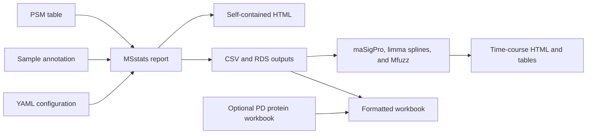

# PDtoMSstats

PDtoMSstats is a configuration-driven workflow that takes Proteome Discoverer
PSM data through quality control, MSstats protein summarization and planned
comparisons, optional formatted Excel export, and independent-sample
time-course analysis with orthogonal-polynomial maSigPro, limma natural
splines, and method-specific Mfuzz clustering.

Docker is the recommended way to run the workflow. The same image is used on
Linux, Windows, Intel macOS, and Apple Silicon macOS, so users do not need to
install R, Quarto, compilers, or individual R packages on the host computer.

## Start here

If you are not comfortable with command-line tools, use the
[one-command guide](docs/command.md). The interactive wrapper asks for the
files and outputs, detects standard columns, writes the resolved configuration,
and calls the existing generalized workflow. No R programming is required for
routine use.

In brief, a user supplies:

- a Proteome Discoverer PSM table;
- a sample annotation table;
- optionally, a protein workbook, contrast file, or advanced YAML settings.

The workflow returns a self-contained HTML report, result tables, figures,
saved analysis objects, and, when a Proteome Discoverer protein workbook is
provided, a formatted Excel workbook.



## Quick test with Docker

Requirements:

- Docker Desktop on Windows or macOS, or Docker Engine with the Compose plugin
  on Linux;
- at least 8 GB RAM available to Docker; 12–16 GB is preferable for large
  studies.

Download or clone this repository and open a terminal in its top-level folder.
The launcher downloads the public container on its first run and starts an
interactive setup:

```bash
./pdtomsstats
```

On Windows PowerShell, use:

```powershell
.\pdtomsstats.ps1
```

Run the bundled de-identified example with one noninteractive command:

```bash
./pdtomsstats run \
  --config config/example-data.yml \
  --outputs html,timecourse \
  --timecourse-config config/example-data-timecourse.yml \
  --non-interactive
```

Both HTML reports appear under `results/example/main/`. Supporting main-analysis
files are grouped under `results/example/supporting/`, time-course CSV/RDS files
stay under `results/example/timecourse/`, and figures are written under
`figures/example/`. The example contains synthetic identifiers and is intended
only to verify the software.

See the [one-command guide](docs/command.md), [Docker instructions](docs/docker.md), and the
[example walkthrough](docs/example.md) for Windows, macOS, and Linux details.

## HPC with Singularity or Apptainer

The same published container runs on HPC without changing the R analysis. The
host-side launcher provides project templates, an Apptainer execution profile,
home isolation, explicit bind mounts, and Slurm submission.

```bash
PDT=/data/Proteomics_IDSS/prod/PDtoMSstats/pdtomsstats
PROJECT=/data/Proteomics_IDSS/projects/my-project

"$PDT" init --project "$PROJECT" --profile biowulf \
  --modules main,timecourse --label "My proteomics project"
```

After copying data and editing the generated YAML files:

```bash
"$PDT" validate --project "$PROJECT" \
  --config "$PROJECT/config/my-project-main.yml" --outputs html

"$PDT" run --project "$PROJECT" \
  --config "$PROJECT/config/my-project-main.yml" \
  --outputs html --cpus 2 --memory 64G --walltime 12:00:00

"$PDT" status --project "$PROJECT"
```

The Biowulf profile makes plain `run` submit a detached Slurm job. Add
`--mode local` to run inside the current allocation. The profile pins
Apptainer 1.4.5 and the 0.2.4 SIF, uses `--containall` rather than injecting
`HOME`, and retains the generated Slurm script and logs in the project. See [standardized projects](docs/standardized-projects.md)
and the complete [HPC guide](docs/hpc-singularity.md).

Projects containing several independent analyses can use filename-based batch
discovery. Name each pair `<analysis-id>__PSM.xlsx` and
`<analysis-id>__protein.xlsx`, add a shared `data/annotation.xlsx`, and run.
The role suffixes are case-insensitive, and `protein` or `proteins` is accepted:

```bash
"$PDT" run --project "$PROJECT" --batch --outputs html,excel
```

The launcher validates every pair before submitting one Slurm job per analysis.
It keeps all job IDs in a batch record, which the normal `status` command
reports together. See [standardized projects](docs/standardized-projects.md#multiple-independent-analyses).

Batch discovery also works when the project contains only one PSM/protein
pair. When inputs follow the batch naming convention, neither the generated
main YAML nor contrast TSV needs to be edited. For custom filenames, either
name the files explicitly with `--psm`, `--annotation`, and
`--protein-workbook`, or edit the main YAML and supply the protein workbook on
the command line. See [choosing batch or explicit inputs](docs/command.md#choose-batch-or-explicit-inputs).

## Analyze a new project

The main report needs:

1. a Proteome Discoverer PSM Excel, CSV, TSV, or tab-delimited TXT file;
2. a sample annotation Excel, CSV, TSV, or TXT file;
3. a YAML configuration copied from `config/example.yml`.

Private inputs can be placed under `data/<project>/`; all data are ignored by
Git except the bundled public example.

```bash
cp config/example.yml config/local-my-project.yml
```

Edit the file paths and design columns, then validate and render:

```bash
docker compose run --rm pdtomsstats \
  Rscript scripts/check_inputs.R config/local-my-project.yml

docker compose run --rm pdtomsstats \
  Rscript scripts/render_report.R config/local-my-project.yml
```

The annotation may contain extra rows. PDtoMSstats matches the PSM and
annotation tables by `File ID` and analyzes only the matching rows. A
`Condition` column can be supplied directly or constructed from any annotation
columns:

```yaml
condition_columns: ["Time", "Group"]
condition_template: "{Time}h_{Group}"
```

See [input files](docs/input-files.md) and the complete
[configuration reference](docs/configuration.md).

## Planned comparisons

Comparisons may be generated automatically, written directly in YAML, or read
from a long-format CSV/TSV/TXT design file. A row in the design file gives one
nonzero coefficient:

| ContrastType | Label | Condition | Weight |
|---|---|---|---:|
| pairwise | Treatment_vs_Reference | Treatment | 1 |
| pairwise | Treatment_vs_Reference | Reference | -1 |

The workflow validates zero-sum coefficients and produces a plain-language
contrast guide that is also added to the optional Excel export.

## Time-course analysis

The time-course report starts from the normalized protein-level RDS produced by
the main report. It is intended for independent biological samples, not
repeated measures. Configure the time and group columns and run:

```bash
docker compose run --rm pdtomsstats \
  Rscript scripts/render_timecourse_report.R \
  config/local-my-project-timecourse.yml
```

It performs balanced group-by-time coverage filtering, orthogonal-polynomial
maSigPro regression, a moderated limma natural-spline interaction test, a
combined significant-protein table, and separate Mfuzz clustering of each
model's comparison-minus-reference effect trajectories. See the
[time-course guide](docs/timecourse.md).

## Optional formatted workbook

If the matching Proteome Discoverer hierarchical protein workbook is
available, run after the main report:

```bash
docker compose run --rm pdtomsstats \
  Rscript scripts/export_workbook.R \
  data/my-project/proteins.xlsx \
  results/my-project
```

The exporter uses only R packages, including `openxlsx2` when a Proteome
Discoverer workbook needs compatibility repair. The result contains a compact
`Proteins` worksheet and a complete hierarchical `Peptide` worksheet;
non-finite statistics are shown as `NA`, `Inf`, or `-Inf`. By default, the
workbook is saved beside the main HTML report under `results/my-project/main/`.
Details are in the [workbook export guide](docs/workbook-export.md).

## Native installation

Docker is not mandatory. A native installation needs R 4.5, Quarto 1.8, system
compilers, and all CRAN/Bioconductor dependencies:

```bash
Rscript scripts/install_dependencies.R
Rscript scripts/check_environment.R
```

Native OS-specific notes are in [installation.md](docs/installation.md).

## Repository layout

```text
.
├── Dockerfile
├── compose.yaml
├── pdtomsstats               macOS/Linux one-command launcher
├── pdtomsstats.ps1           Windows PowerShell launcher
├── msstats-psm-report.qmd
├── timecourse-masigpro-mfuzz.qmd
├── config/                 Configuration templates and public example configs
├── data/example/           Small de-identified runnable example
├── R/                      Reusable analysis helpers
├── scripts/                Validation, rendering, export, and setup tools
├── templates/              Optional custom report-section examples
├── docs/                   User and method documentation
├── tests/                  Lightweight repository and example checks
├── results/                Generated outputs; ignored by Git
└── figures/                Generated figures; ignored by Git
```

## Reproducibility and privacy

- The container pins R 4.5.2, Bioconductor 3.21, and Quarto 1.8.26.
- Random operations use fixed seeds recorded in configuration files.
- Every report saves its parameters and R session information.
- Input data, local configuration files, results, figures, RDS files, and
  workbooks are ignored by Git by default.
- The public example is pseudonymized and explicitly unsuitable for biological
  inference.

## Citation and license

Citation metadata are provided in `CITATION.cff`. Scientific analyses should
also cite MSstats, maSigPro, Mfuzz, Quarto, and enrichment packages used in the
rendered report.

No distribution license has been selected yet. Replace `LICENSE` with the
owner-approved license before publishing the repository publicly.

Maintainers should follow the [GitHub publishing guide](docs/publishing.md)
before sharing the repository. It covers private-first publishing,
collaborator access, releases, GitHub Pages, and the prebuilt container image.
